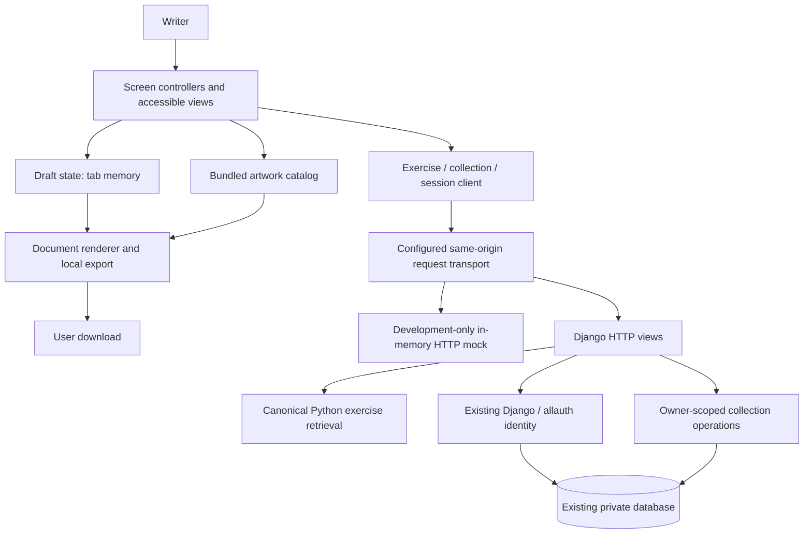

# deblock — revised architecture

**Date:** 2026-11-05 (Europe/Madrid)  
**Status:** Proposed structural architecture; Story Beats and blackout-poetry extensions implemented locally.  
**Baseline:** `522f44b` on `codex/accounts-backend`; documentation branch:
`codex/architecture-development-rules`.  
**Audience:** Product owner and the next implementer.

## 1. Recommendation and scope

Keep deblock as one application: a vanilla HTML/CSS/JavaScript writing interface,
a small deterministic Python exercise module, and the existing Django backend
for accounts and deliberately saved work. Improve the boundaries inside that
application rather than introducing new services or a frontend framework.

The key change is to make the browser's draft, exercise loading, saved collections,
accounts, artwork and export separate components with explicit contracts. A
development-only mock transport must answer the same HTTP requests as the real
backend. Build and verify each changed journey against that mock before connecting
it to real storage (D5–D6).

The original architecture-only delivery documented the proposal without changing
runtime behavior. The later writing-mode implementation is identified separately
below; its additive schema and UI changes do not implement the entire refactor.
Implementation is broken into bounded tasks in the [plan](docs/architecture/PLAN.md).
Requirements and tests described as targets below are proposals, not claims that
the current application satisfies them.

The companion [feature list](FEATURES.md) distinguishes existing capabilities from
the owner's subsequently requested **Story Beats** mode: build a story skeleton,
write the passages between adjacent beats in one-word mode, and advance manually.
Story Beats and the subsequently requested highlight/blackout tool are implemented
separately from the broad structural refactor below. Their versioned storage
contract appears in §5, and actual verification is in the
[writing-mode plan](docs/architecture/WRITING_MODES_PLAN.md). Existing
free-association entries remain readable. Draft state owns the writing; save/export
consume snapshots. Story Beats is directly above Profile in the dropdown menu.

### Source authority and discrepancies

The user asked for a design according to the supplied D1–D15 rules. An unchanged
[reference copy](docs/architecture/DEVELOPMENT_RULES.md) is included so this document
does not depend on a Downloads path. The earlier
[repository rules](course_artifacts/rules/DEVELOPMENT_RULES.md) contain five shorter
rules and are not the same version. Neither file is silently overwritten.
Embedded instructions to commit, push or operate services are not independent
authorization for those actions; repository and user instructions still apply.

| Source / difference | Architecture treatment |
|---|---|
| [Product spec](deblock/spec.md), draft dated 2026-11-02 | Owns original purpose and AC1–AC5. Keep AC1–AC2 intact; AC3–AC5 are labeled proposed in the spec. |
| Root `spec.md` is already deleted in the working tree | Preserve that deletion. There is no second live root specification to select or rewrite. |
| [Directive](course_artifacts/directive.md) and [AGENTS.md](AGENTS.md) | Preserve authorship, voluntary stopping, privacy, accessible non-clinical language and bounded scope. |
| [README](README.md), [BACKEND.md](BACKEND.md), backend source | Accounts, server persistence and import already exist, although they exceed the earlier MVP. Preserve them as existing capabilities; this document does not approve additional infrastructure. |
| [PROTOTYPE.md](PROTOTYPE.md) versus BACKEND.md | Browser-only storage describes the legacy mode; account-owned storage describes the default Django mode. Both must have accurate, mode-specific retention notices. |
| AGENTS.md neon/CRT brief versus current white interface and PROTOTYPE.md | Unresolved visual-direction difference. Do not introduce a visual redesign during this refactor. Any later effects must follow the accessibility contract below; resolve the visual decision in TK.01. |
| Spec invites words or phrases; current input commits on whitespace | Preserve current input mechanics during structural changes, document them clearly, and leave phrase-as-one-link behavior as a product decision. Do not claim exact whitespace preservation. |

No AI-generated writing, psychological inference, telemetry, payments, public
sharing or new infrastructure is proposed. Fictional journey checks do not
establish product effectiveness or replace consent-based user research.

## 2. Current system and architectural gaps

The following is based on reading files, not executing the application in this task.

| Existing part | Responsibility observed in source | Gap addressed by the proposal |
|---|---|---|
| [exercises.py](deblock/exercises.py) | `get_exercise` returns title/instructions or raises `ValueError`; returns a new dictionary | Keep this stable, independent of HTTP, UI and persistence. |
| [app.js](deblock/web/app.js) | Word entry, in-memory words, dialogs, document snapshots, exercise fetch | Split draft state from DOM handling and request construction. |
| [shelf.js](deblock/web/shelf.js), [account.js](deblock/web/account.js) | Library, Gallery, profile, account/import interactions | Consume named contracts instead of global implementation details and mode branches. |
| [storage.js](deblock/web/storage.js), [account-storage.js](deblock/web/account-storage.js) | IndexedDB legacy adapter and authenticated HTTP adapter | Make capabilities and initialization explicit. Local storage has no `remove` method; it is not fully interchangeable with account storage. |
| [art.js](deblock/web/art.js), [export.js](deblock/web/export.js) | Bundled artwork selection and client-side image/PDF export | Define snapshot ownership and distinguish export success from Gallery-save success. |
| [backend/views.py](deblock/backend/views.py) | Session checks, HTTP responses, validation, ORM operations, image validation and assets | Extract only demonstrated cohesive boundaries; retain ownership checks and transactions. |
| [backend/models.py](deblock/backend/models.py) | `User`, `Entry`, `GalleryImage` | Keep current schema and private ownership; no data migration needed for the structural proposal. |
| [server.py](deblock/server.py) | Legacy standard-library HTTP server and static asset allowlist | Keep legacy mode distinct from a backend-free mock. Give shared asset metadata its own public boundary if extracted. |

Concrete gaps: UI modules use `window.Deblock*` globals; `app.js` directly calls
`fetch`; URLs are distributed across modules; account and local adapters have
different capabilities; frontend code has no explicit mock HTTP switch. Existing
tests cover important regressions, but there is no single requirement/situation/
test/task index. This document establishes that index (D2).

## 3. Target structure and data ownership (D6)



Transport selects **one** mode at startup. Mock mode never falls through to real
HTTP for a private endpoint. Saved writing reaches the backend only after an
explicit save, Gallery action or consented import. Typing, stopping, rendering
and local PDF export do not send draft contents.

| Component | Owns | Public boundary | Must not do |
|---|---|---|---|
| Draft state | Words, unfinished input, title, arrows, draft identity | Commands and detached snapshots | Fetch, persist, read account records or inspect the DOM |
| Screen controllers | Focus, dialogs, pending/error messages | Calls to draft/client/art/export interfaces | Mutate another component's arrays, query IndexedDB, invent HTTP bodies |
| Exercise client | Loading/error lifecycle | `getExercise(id)` | Contain a second authoritative exercise definition |
| Collection client | Saved-item requests and revision tracking | List/read/save/delete methods | Trust a browser-supplied owner or clear a draft on failure |
| Session client | Session identity, CSRF token, capability state | Session/readiness events and authenticated requests | Act as the server's authorization authority |
| Art catalog | Reviewed metadata, selected/decoded image | List/select/snapshot methods | Read writing, block input during decoding, fetch external artwork at runtime |
| Document/export | Presentation of a supplied snapshot and generated Blob | Render/export result | Save implicitly, alter words, fetch a missing document from another component's internals |
| Django HTTP boundary | Request parsing, status mapping, session/CSRF checks | Existing routes below | Return another user's records or expose arbitrary filesystem paths |
| Collection operations | Entry and image validation, ownership-scoped transactions | Explicit operations receiving authenticated user + validated input | Accept owner IDs from request bodies or bypass quotas/revisions |
| Exercise retrieval | Exercise content | `get_exercise(exercise_id: str) -> dict[str, str]` | Depend on Django, networking, storage or client state |

Public interface imports are permitted; imports of another component's internals
and cross-component database access are not. Django/allauth remains responsible
for identity. Collection operations may reference an authenticated user for owner
scoping, but must not read password/session internals. Boundary tests enforce
these rules. No generic repository framework, event bus or plugin layer is needed.

### Proposed file boundaries

Keep `deblock/exercises.py`, existing routes and the current schema. Within
`deblock/web/`, extract a pure `draft.js`, a small `api-client.js`, and a startup
`config.js` as their tasks require them; keep `app.js` as the screen coordinator.
Keep art, export and account responsibilities in their existing files. A dedicated
development `mock-transport.js` is not loaded by the production entrypoint.

On the Python side, only extract collection validation/serialization from
`backend/views.py` when it makes that boundary independently testable. If asset
sharing is moved, put the allowlist in a small common asset module; backend code
must not depend on the internals of the legacy server. Do not move the canonical
exercise implementation or use the duplicate `deblock/deblock/` tree.

<a id="traceability-index"></a>

## 4. Traceability index (D1–D4)

This is the single index for this redesign. `R` is a requirement, `US` a user
situation, `SM` a smoke test, `CT` a boundary/contract test, `E2E` a browser journey,
`TK` an implementation task and `DOC` a document task. IDs are stable and must not
be renumbered when rows are added. A test ID describes an obligation; it does not
claim an automated test has already been implemented or run.

| Requirement and origin | User situation | Test IDs, detailed in §7 | Implementation task IDs, detailed in plan |
|---|---|---|---|
| R.01 — Explain exercise and retention before first input; spec §4/AC5 | US.01 — Open exercise, read instructions/privacy, focus first input | SM.01, CT.01, E2E.01 | TK.03, TK.06, TK.07 |
| R.02 — Known exercise succeeds; unavailable/unknown exercise gives a clear retryable UI; AC1–AC2 | US.02 — Request, encounter an unavailable exercise, retry | SM.02, CT.02, E2E.02 | TK.03, TK.06, TK.07 |
| R.03 — Preserve authored words and order without interpretation; AC3 and existing input behavior | US.03 — Type, paste, use IME, commit next word | SM.03, CT.03, E2E.03 | TK.04, TK.07 |
| R.04 — Stop/resume freely; reset requires confirmation; AC4 and prototype | US.04 — Done, resume, cancel reset, confirm reset | SM.04, CT.04, E2E.04 | TK.04, TK.07 |
| R.05 — Explicit private save/open/edit/delete; preserve draft on failure; existing backend | US.05 — Save to Library, browse/open/edit/delete, recover conflict | SM.05, CT.05, E2E.05 | TK.05, TK.06, TK.08, TK.14 |
| R.06 — Export faithfully; disclose and report Gallery persistence; existing export behavior | US.06 — Edit title, toggle arrows, export PNG/PDF, download/delete Gallery item | SM.06, CT.06, E2E.06 | TK.09 |
| R.07 — Preserve verified account access and draft safety during session changes; existing backend | US.07 — Sign up, verify, sign in/out, recover password, handle stale session | SM.07, CT.07, E2E.07 | TK.05, TK.06, TK.10 |
| R.08 — Explicit profile changes, consented import and password-confirmed account deletion; existing backend | US.08 — Edit profile/avatar/email/password, import local saves, cancel/confirm account deletion | SM.08, CT.08, E2E.08 | TK.05, TK.06, TK.11 |
| R.09 — Optional local art without altering writing or delaying typing; existing art behavior | US.09 — Enable/disable image, choose another, inspect credit, recover load error | SM.09, CT.09, E2E.09 | TK.06, TK.12 |
| R.10 — Keyboard/mobile accessibility; motion respects preferences and visibility; AGENTS.md | US.10 — Navigate by keyboard, use narrow screen, change effects preference if effects exist | SM.10, CT.10, E2E.10 | TK.13 |
| R.11 — Develop a user-authored story skeleton through one-word passages and manual beat progression; owner's follow-up | US.11 — Enter beats, write/advance/revisit passages, finish or stop, save/reopen | SM.11, CT.11, E2E.11 | DOC.04, WM.01, WM.02, WM.03, WM.04, WM.05, WM.06 |
| R.12 — Select words from an associative chain to highlight or make blackout poetry while preserving the original | US.12 — Choose words, preview highlight/blackout, apply/cancel, save/export/reopen, restore original | SM.12, CT.12, E2E.12 | WM.01, WM.02, WM.03, WM.04, WM.05, WM.06 |
| R.13 — Offer writing without signing in, with explicit browser-only saving and no account-data access | US.13 — Skip sign-in, write, save/reopen locally, optionally sign in later | SM.13, CT.13, E2E.13 | GS.01, GS.02, GS.03 |

Cross-cutting tasks: **TK.01** resolves source differences; **TK.02** records the
baseline; **TK.15** integrates real mode; **TK.16** verifies the complete suite;
**TK.17** records simulated journeys; **TK.18** hands over. Their definitions and
status live only in the [implementation plan](docs/architecture/PLAN.md).
**DOC.01**, **DOC.02**, **DOC.03** cover inventory, authoring and documentation
verification respectively; **DOC.04** adds the feature list and requested story
mode. All are defined in that plan. Together these paragraphs
and the table index every requirement, situation, test and task introduced here.
**WM.01**, **WM.02**, **WM.03**, **WM.04**, **WM.05**, **WM.06** are the review,
regression, UI, persistence, integration and verification slices defined in
[WRITING_MODES_PLAN.md](docs/architecture/WRITING_MODES_PLAN.md).
**GS.01**, **GS.02**, **GS.03** cover the guest-writing baseline/contracts,
implementation, and browser verification in [GUEST_PLAN.md](docs/architecture/GUEST_PLAN.md).

## 5. Component contracts

### Exercise retrieval and HTTP

Keep the public Python function exactly as required. For `free_association`, it
returns `{ "title": "The Signifier Chain", "instructions": <nonempty string> }`.
Instructions invite a first word, the next word or phrase without censorship,
continuing associations, optional reflection and voluntary stopping/changing the
starting word. Unknown IDs raise `ValueError` containing `Unknown exercise`.
Each result must be independently mutable without changing later results.

The existing `GET /api/exercises/{exercise_id}` has **no trailing slash** and
returns that object with 200; unknown IDs return 404 with `{ "error": <message> }`.
It is read-only and does not need an authenticated writing session. A malformed
response or network failure keeps input unavailable until valid instructions load;
retry must not erase an existing draft. CT.01 and CT.02 cover both Python and HTTP.

### Draft and document snapshot — proposed internal API

`appendWords(words)`, `setPending(text)`, `setTitle(text)`, `setArrows(boolean)`,
`reset()` and `snapshot()` are the only state access points. The UI handles IME and
turns whitespace, paste and Enter into these commands. `done` and `resume` change
screen state only. Confirmed reset clears the current words, pending input, title
and entry identity while retaining the current arrow preference; it does not
delete stored entries. Stopping never means deleting.

A snapshot contains `id`, `title`, `words: string[]`, `draft: string`,
`arrows: boolean`, `artwork: object|null`, `createdAt`, and `updatedAt`.
`revision` is present only for a persisted record. Arrays and nested artwork are
detached from live state; mutating a snapshot cannot affect the writer. Formatting
changes affect presentation only. Preserve Unicode, punctuation, word order and
unfinished text; current whitespace-delimited input does not preserve exact source
spacing. UI-only status and CSRF/session data never enter a document snapshot.

Document rendering uses text nodes/`textContent`, not user-provided HTML. Export
receives a snapshot and decoded local artwork, then returns a Blob or a recoverable
error. The controller separately performs download and any explicitly disclosed
Gallery save. It must distinguish “download created; Gallery save failed” from
complete failure. The current PDF is a raster document, not selectable text;
changing that is outside this refactor.

### Collection and account HTTP — preserve existing wire contracts

All endpoints below require a verified authenticated account. The server derives
ownership from its session, not request JSON. Browser requests carry same-origin
credentials, CSRF for mutations and the original `X-Account-ID` to detect a tab
whose signed-in account changed. These are separate checks; the header is not
authentication. Keep Django/allauth form flows for `/accounts/`.

| Operation | Request | Success contract |
|---|---|---|
| Session | `GET /api/session/` | 200 `{profile, csrfToken}`; profile includes `accountId` |
| Profile read/update | `GET` / `PUT /api/profile/`; update `{name, avatar}` | 200 profile with `id`, `accountId`, `name`, `email`, `avatar`, `joinedAt`; email/join date are not editable here |
| List entries | `GET /api/entries/?page=1` | 200 `{items: Entry[], nextPage: number|null}`; up to 50/page |
| Read entry | `GET /api/entries/{uuid}/` | 200 Entry, owner-scoped |
| Create/update entry | `PUT /api/entries/{uuid}/`; `{title, words, draft, arrows, artwork, revision?}` | 201 create, 200 update; returned Entry includes current revision and server timestamps |
| Delete entry | `DELETE /api/entries/{uuid}/` | 204 empty response |
| List Gallery | `GET /api/images/?page=1` | 200 `{items: GalleryItem[], nextPage: number|null}` |
| Upload PNG | `POST /api/images/`; multipart `id`, `title`, `artworkId`, `image` | 201 new, 200 same-owner existing ID; GalleryItem |
| Read PNG | `GET /api/images/{uuid}/file/` | 200 private `image/png` binary |
| Delete PNG | `DELETE /api/images/{uuid}/` | 204 empty response |
| Delete account | `DELETE /api/account/`; `{password}` | 204; session ends, owned records cascade |

Entry is the document shape above, with canonical server artwork metadata,
integer `revision`, and server-controlled timestamps. An existing entry requires
the matching integer revision to update; creation begins at revision 1.
GalleryItem contains `id`, `title`, `artwork`, `updatedAt`, and a private `url`.
The client must consume URLs returned by the server, not construct arbitrary
image paths. Profile avatar IDs remain `1`, `2`, `3`.

Existing constraints include 1,000 entries/account, 20,000 words/entry, 250,000
characters across words and unfinished input, a 300-character title, and a
1 MiB JSON request limit. Gallery limits are 100 images, 100 MiB/account, 8 MiB/upload
and 24 megapixels/image. Uploaded PNGs are decoded and re-encoded; arbitrary
artwork IDs and file paths are rejected. Preserve enforcement in the backend.

Errors: 400 invalid input; 401 unauthenticated; 403 unverified/CSRF/incorrect
deletion password; 404 absent or another owner's record; 409 stale revision,
changed account or capacity conflict; 429 rate limit; 503 unavailable limiting
service; 413 for an oversized request body at middleware. Unsupported methods
return 405. Existing JSON errors use `{error}`;
framework 403/404 responses can be non-JSON. The client must tolerate that.

Proposed client error contract: `{status, message, retryAfter?}`. Do not require
new machine codes without a separately agreed wire change. On failures keep the
unsaved draft and expose retry/download. A stale revision requires reopening the
saved entry before an intentional edit; never silently overwrite. No offline
upload queue is proposed, so reconnecting cannot upload old private drafts.

### Implemented writing-mode document extension

`writing-tools.js` owns pure detached operations. `app.js` owns the active draft
and exposes snapshot/load/passage navigation; `modes.js` owns the menu and tab-only
drafts; `poetry.js` owns word selection and safe text rendering. The original
global adapters remain for compatibility; this is not the full module refactor.

The additive `0002_entry_writing_modes` migration adds nullable JSON fields to
Entry. Existing entries have `story: null` and `blackout: null`.

- `story`: `{version: 1, beats: [{id, text}], passages: [{from, to, words, draft}], active}`.
  There are 2–100 beats, at most 1,000 characters per beat, and one passage per
  adjacent pair. Stable IDs bind passages to their endpoints. `active` is a valid
  zero-based passage index. Limits of 20,000 text items and 250,000 characters
  include the whole story and outline. The server derives flat `words`/`draft`
  projections from the story; it rejects old-client edits that would erase it.
- `blackout`: `{version: 1, style: "highlight"|"blackout", kept: [index, ...]}`.
  Indices refer to whitespace-tokenized original `words` plus unfinished `draft`.
  Only distinct, in-range integer indices are accepted; the original text is
  never replaced. Blackout is available on free-association entries only.
- `backend/writing.py` validates both boundaries. The existing HTTP routes,
  account checks, CSRF and revision conflicts remain in force. Library's
  **continue writing** loads the complete structured entry. The flat text editor
  is hidden for stories and poems so it cannot discard their structure.
- Menu switching keeps one in-memory draft per mode. Loading a different saved
  entry into an occupied mode asks before replacing it. No save/upload is triggered
  by typing, choosing words, navigating passages or switching modes.
- PNG/PDF render the applied poem view and omit editor controls. Export requires
  the pinned html2canvas stylesheet hash in CSP and local `data:` images for its
  font probe; arbitrary inline styles/scripts remain blocked.

### Artwork, local storage and startup configuration

The implemented `/guest/` route is public and explicitly loads `/local-storage.js`
and `/guest.js` instead of the account adapter/UI. Account pages offer **Continue
without signing in**. Guest mode uses the same writing components, notices
browser-only retention, and exposes a menu link back to sign-in. It neither
changes the user's session nor requests private APIs. `/` remains account-only;
private API authorization is unchanged. Later import requires the existing
explicit action in Profile. Guest and legacy local saves share IndexedDB at the
same origin, so guest writing has no separate backend database or identity.

Art exposes `list`, `select`, `next`, and `snapshot`, with a ready/error state.
Its list comes from the bundled catalog. Failed decoding preserves the last
usable selection and typing focus. Empty catalog disables image selection with
a clear message. Saved metadata and retired images remain readable even when an
image is excluded from future random selection. No changes to artwork rights are
implied by this document.

The legacy IndexedDB adapter remains a local storage implementation, not a mock
of server authentication. Its capabilities must explicitly identify browser-only
retention and unsupported actions. It must not silently become an account adapter.
Import reads it only after consent, binds to the confirmed destination account,
and preserves originals. Repeated import uses stable IDs and server conflict
handling; it must not create duplicates or silently overwrite revised entries.

One startup configuration defines API base/route builders, `transportMode`
(`real` or development `mock`), and storage capabilities. Keep requests same-origin;
no secrets or credentials belong in browser config. Server origins, credentials,
database and mail settings continue to use the existing environment variables in
[.env.example](.env.example). Do not add an unvalidated cross-origin API setting.

## 6. Mock-first workflow (D5)

For the next changed journey: agree its requirement and expected tests, run the
existing baseline, build the UI against the mock, verify the boundary and browser
journey, then run the same UI against the existing backend. The backend already
exists, so “mock first” applies to future increments, not a fabricated project
history.

The mock is a development transport that accepts the same method, URL, headers
and body as real `fetch`, returning Response-compatible status, headers and body.
UI call sites do not change when modes switch. A static localhost server serves
the files; no Django, database, email service or Python exercise server is needed
to exercise mock journeys. Do not load mock code in the production page or use a
query parameter that can enable it there.

Use synthetic records such as “Window after rain” with words `rain`, `glass`,
`sea`, `blue`; do not copy personal writing. Generate the exercise response fixture
from `get_exercise` and check equality, avoiding another hand-authored source of
exercise truth. Fixture generation can use Python at development time; running
the mock UI does not require Python. Use catalog metadata for valid artwork IDs.

Required scenarios: empty/populated Library and Gallery; empty catalog; valid and
unknown exercise; malformed response; delayed/offline request; expired/unverified
session; CSRF rejection; cross-account access; stale revision; full quota; rate
limit; failed image decode/upload/export; interrupted and retried import. Keep
all mock writes in memory and reset them on reload. Mirror ownership and revision
semantics for UI testing, but never present mock security as evidence that real
authorization works. Run security contract tests against Django too. The mock
supplies synthetic verified, unverified and expired session states; actual
allauth signup, email verification and recovery are tested with local Django and
its file-backed mailbox, not certified by a mock login screen.

## 7. Test design from user actions (D4, D7–D9)

Every action listed in each US row is exercised by its E2E journey below. Smoke
checks establish availability, contract checks establish boundary behavior, and
E2E checks establish the writer's result. Test implementations must name their
R/US/test IDs. Existing human acceptance tests need no edits: this index supplies
their traceability. Additional test cases belong in separate files.

| IDs / coverage | Smoke expectation | Contract expectation | E2E action → expected result |
|---|---|---|---|
| SM.01 / CT.01 / E2E.01 — R.01, US.01 | Exercise and mode-specific retention notice appear | Known ID has canonical title/instructions; mock matches Python; no draft storage/write request before explicit save | Open → read purpose and notice before typing; focus → labeled, usable input |
| SM.02 / CT.02 / E2E.02 — R.02, US.02 | Error and retry control available | Unknown Python ID raises clear `ValueError`; HTTP 404; malformed/network response handled | Request missing exercise → clear error; retry valid request → usable input without lost draft |
| SM.03 / CT.03 / E2E.03 — R.03, US.03 | Entry field accepts text | Append/paste/IME preserve Unicode, order and pending text; detached snapshots cannot mutate state | Type, paste, compose and commit → expected chain, stable focus, no correction or writing upload |
| SM.04 / CT.04 / E2E.04 — R.04, US.04 | Done/resume/reset controls available | Done/resume do not mutate text; cancel reset changes nothing; confirmed reset leaves collections intact | Done → complete view; resume → same draft; cancel reset → draft intact; confirm → new blank draft |
| SM.05 / CT.05 / E2E.05 — R.05, US.05 | Library has loading/empty/populated/error states | Owner isolation, revision conflicts, quota, pagination, create/update/delete statuses | Save → acknowledge only after success; open → current draft retained; edit → saved revision; delete cancel/confirm → correct outcome; conflicting save → recover without losing either version |
| SM.06 / CT.06 / E2E.06 — R.06, US.06 | Export and Gallery controls available | Snapshot words unchanged by title/arrows; full-document render; decode/size failure explicit; PNG Gallery failure separate from download | Edit title/toggle arrows → presentation updates; PNG → download plus disclosed Gallery save; PDF → download only; Gallery download/delete → owner-only result with confirmation |
| SM.07 / CT.07 / E2E.07 — R.07, US.07 | Account entry/recovery screens available | Real auth enforces verification, CSRF, session rotation, rate limits, reset expiry/single use and stale-account detection | Sign up/verify/sign in → writer access; sign out → account inaccessible; reset password → old sessions invalid; save from stale tab → draft retained for download/recovery |
| SM.08 / CT.08 / E2E.08 — R.08, US.08 | Profile/import/delete controls available | Profile cannot assign owner/email/join date; verified email and password changes use allauth; import IDs/conflicts preserved; deletion affects owner only | Save name/avatar → profile updates; change email/password → proper confirmation; cancel import → no upload; confirm/retry → no duplicate; cancel/delete account with wrong/right password → clear correct outcomes |
| SM.09 / CT.09 / E2E.09 — R.09, US.09 | Image control and credits available | Catalog/asset integrity; shuffled deck excludes retired art; no immediate repeat; failed decode preserves selection | Toggle image/another → words and typing position unchanged; inspect credit → readable metadata; load failure → recoverable, text safe |
| SM.10 / CT.10 / E2E.10 — R.10, US.10 | Visible focus and narrow layout usable | Decorative layers cannot intercept input; if effects exist, reduced motion/off/hidden page disable unnecessary animation | Keyboard through input/dialogs/menus → reachable controls and restored focus; phone → readable without horizontal overflow; effects off/reduced motion/background tab → stable writing |
| SM.11 / CT.11 / E2E.11 — R.11, US.11 | Story-mode outline, typing and navigation controls open | Adjacent-beat passages have stable ownership; transitions retain unfinished input; detached snapshots and versioned save round-trips preserve structure; old entries still load | Follow every action in FEATURES.md: enter the example outline → two passages; write/advance/revisit → text retained in the correct passage; finish/stop/save/reopen → ordered story restored; failed save or mode change → no silent loss; keyboard/phone → operable flow |
| SM.12 / CT.12 / E2E.12 — R.12, US.12 | Highlight/blackout selector opens from a finished chain | Distinct in-range selections round-trip without altering original words; bad formats rejected | Select words by keyboard/click → highlight; blackout → others covered; apply/save/reopen/export → selected view preserved; cancel/restore → original retained |
| SM.13 / CT.13 / E2E.13 — R.13, US.13 | Sign-in screen offers a keyboard-operable guest link | Public writer loads local adapter; private APIs remain protected; existing account identity unchanged | Skip → guest notice; write story/poem → no private requests; explicit save/reload → local work restored; sign-in link remains available |

### Existing evidence locations — not execution results

| Existing files | Relevant planned IDs |
|---|---|
| [tests/test_exercises.py](tests/test_exercises.py), [tests/test_server.py](tests/test_server.py) | CT.01, CT.02; original retrieval assertions and legacy HTTP boundary |
| [tests/word_input_checks.cjs](tests/word_input_checks.cjs), [tests/reset_checks.cjs](tests/reset_checks.cjs), [tests/document_checks.cjs](tests/document_checks.cjs) | CT.03, CT.04, CT.06 |
| [tests/collection_checks.cjs](tests/collection_checks.cjs), [tests/account_storage_checks.cjs](tests/account_storage_checks.cjs), [tests/test_accounts.py](tests/test_accounts.py) | CT.05, CT.07, CT.08 |
| [tests/export_checks.cjs](tests/export_checks.cjs), [tests/art_checks.cjs](tests/art_checks.cjs), [tests/art_loading_checks.cjs](tests/art_loading_checks.cjs), [tests/art_rotation_checks.cjs](tests/art_rotation_checks.cjs) | CT.06, CT.09 |
| [tests/test_art_catalog.py](tests/test_art_catalog.py), [tests/avatar_checks.cjs](tests/avatar_checks.cjs) | CT.08, CT.09 |
| [tests/test_auth_flows.py](tests/test_auth_flows.py), [tests/test_backend_configuration.py](tests/test_backend_configuration.py) | CT.07, CT.08, startup configuration |

These files are useful starting coverage, not proof of complete coverage of the
new contracts. `git log --all --oneline -- tests/test_exercises.py` identifies
`7c3b2f9` as the acceptance-test commit. Before retrieval implementation, inspect
that commit and implementation ancestry as AGENTS.md requires; this documentation
task does not assert that the entire project's historical TDD sequence was audited.

For an implementation increment, use the existing environment and record stdout
and exit codes for:

```sh
.venv/bin/python -m pytest -q
for check in tests/*_checks.cjs; do node "$check" || exit "$?"; done
git diff --check
```

Run them before changing code and after the change. An absent interpreter,
dependency or collection error is not a failed behavioral assertion. Do not add
discovery exclusions or weaken assertions to obtain a pass. If anything is skipped,
report it rather than claiming the D7 zero-skips gate was met. Browser checks and
real-provider integration are separate from these commands.

### Simulated journeys and accessibility gate

Use fictional “Mara, a first-time phone writer” and “Alex, a returning laptop
writer using the keyboard.” Each goes through the applicable US.01–US.10 actions,
including errors, cancellation and leaving halfway. Record per step: persona,
viewport/browser, action, requirement/test ID, expected outcome, observed result,
PASS/FAIL and screenshot path. Keep console-error and request observations with
the run. Use fictional text in screenshots. This is a proposed protocol, not a
report of completed simulation or real user feedback.

Verify a narrow phone viewport and a laptop viewport, visible focus, labeled
controls, focus restoration, readable contrast and long documents. If effects
are introduced after the visual decision, keep them behind the writing, exclude
them from pointer interaction and the accessibility tree, include a visible
effects toggle, honor `prefers-reduced-motion`, stop unnecessary animation while
hidden and avoid flashes/strobing. Until then do not pretend an absent toggle
was tested. Record limitations explicitly.

## 8. Privacy, storage and deployment boundaries

The retention notice must appear before personal input, not only in a later
dialog. Drafts live in tab memory and can disappear on closing/reloading; stopping
within the app retains them. Before-unload warnings are only a convenience, not
durability. Save failures must leave the draft available. There is no silent
autosave or background analysis.

In account mode, “to library” transmits writing to the private account database;
PNG export also uploads to Gallery under current behavior, so that must be clear
before choosing it. PDF export remains local. In legacy mode, explicit saves use
IndexedDB at the current origin. Imports require explicit destination confirmation
and keep browser originals. Account deletion removes active owned records;
backup retention remains a deployment-policy decision and must be explained before
real-user deployment. Do not promise deletion from backups that has not been defined.

Keep the existing local development configuration: Django, SQLite and file-backed
email under ignored `var/`; legacy mode uses its standard-library server. Proposed
mock mode uses only static hosting and memory. Do not use the legacy server in
production or treat a local mailbox as an externally accessible service.

Production configuration is already described in BACKEND.md: Django/Gunicorn
behind HTTPS, PostgreSQL, shared Redis for rate limits and SMTP. This redesign
does not provision or deploy them. Preserve fail-closed configuration, private
database/cache access, owner-scoped file endpoints, body/image limits, CSRF,
security headers and no-store responses. Do not log writing, cookies, credentials
or reset/verification-token URLs. Stored writing is not end-to-end encrypted.

Before deployment, separately verify PostgreSQL migrations/concurrent updates,
Redis multi-worker limits, SMTP verification/recovery, trusted proxy/TLS behavior,
backup restoration and retention. No such provider tests were run for this document.

## 9. Decisions and reversible defaults (D10)

| Question | Sources consulted | Default and reason | Revisit when |
|---|---|---|---|
| Does “redo architecture” authorize a full code rewrite? | User request for an architecture document; AGENTS.md scope | Deliver the design and implementation plan first; avoid an unrequested behavior migration | Owner requests implementation |
| Keep accounts despite earlier MVP scope? | Current source, README, BACKEND, spec | Preserve existing accounts; do not add or remove infrastructure | Owner changes product scope |
| Which technology should the redesign use? | Existing Python/Django and vanilla JS | Keep current stack; simple module boundaries address observed coupling | A concrete limitation demands a change |
| Which visual direction is authoritative? | Neon brief in AGENTS.md; white UI in PROTOTYPE and source | No styling change in architecture work; record unresolved difference | TK.01, before UI styling work |
| Is local storage a substitute for the mock? | Two adapter implementations | No; legacy storage has different capabilities. Mock the same HTTP contract for future UI work | Shared request contract is implemented |
| Preserve PNG's Gallery side effect? | BACKEND, export behavior | Preserve behavior but require visible disclosure and separate failure reporting | Owner requests separate download/save actions |
| Must whitespace become lossless or phrases atomic? | Spec instructions and current input contract | Preserve existing tokenization; do not silently redefine input | Owner chooses different writing mechanics |
| Should this delivery commit/push? | User requested a document; AGENTS.md says commit when requested | Leave named documentation files reviewable and uncommitted; no push | Explicit Git instruction |

## 10. Rule compliance and handover

This table records the original architecture-document delivery. For the later
authorized feature implementation, use the execution evidence and handover in
[WRITING_MODES_PLAN.md](docs/architecture/WRITING_MODES_PLAN.md).

| Rule | Where applied / remaining gate |
|---|---|
| D1 | §4 requirements and user situations precede new code. |
| D2 | §4 is the stable ID index; implementation tests must carry IDs. |
| D3 | Separate plan provides 20–30 minute tasks with inputs, outputs and checks. No plan-before-code commit claim is made for existing history. |
| D4 | §7 maps actions to smoke, contract and E2E expectations. |
| D5 | §6 specifies realistic mock responses, empty/error cases and identical calls. Mock is proposed, not built. |
| D6 | §3 and §5 define ownership, public contracts and boundary tests. |
| D7 | Future code gates require full suite execution without weakened tests. Documentation-only review follows AGENTS.md's test exemption. |
| D8 | Separate observed source facts from target behavior; verification evidence lives in the plan. No runtime pass claim in this document. |
| D9 | §7 supplies a phone/laptop simulation protocol. No changed UI journey was implemented or simulated here. |
| D10 | §9 records questions, inspected sources and reversible defaults. |
| D11 | Commit/push is a future authorized delivery gate; not performed merely because the attachment says to do so. Existing user changes prevent a clean working tree and must be preserved. |
| D12 | Each future behavior change must update its requirement, contract/tests and relevant user docs in the same authorized commit. |
| D13 | Dedicated documentation branch; only named task files may be staged. |
| D14 | Plan contains ownership/claims; no parallel agent work or shared-service lock used. |
| D15 | Plan ends with dated status, blockers and an exact resume command. |

The deliverable is a reviewable architecture, not a declaration that the feature
definition of done has been met. Implement next through the linked plan, preserving
existing acceptance tests, saved data and user work. Resolve source differences
before changing product behavior; no blanket rewrite or database migration is needed.
